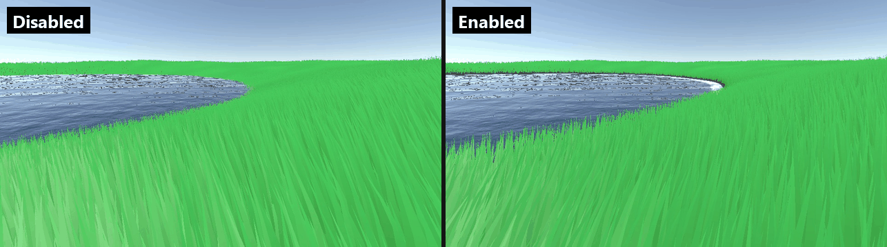

# How it works

This page explains the moving parts, so the settings in the [reference](reference.md) make sense.

## Two pieces: the feature and the renderer

**Grass Data Renderer Feature** lives on your URP renderer asset. It does all the GPU work: captures, generation and drawing. It owns the GPU buffers and textures, one set per camera, and keeps them between frames.

**Infinite Grass Renderer** is a scene component. It holds the scene's settings (material, spacing, draw distance, LOD, capacity, plant kinds) and the shared blade meshes. There is one per scene: the enabled renderer registers itself as `InfiniteGrassRenderer.Instance`, and a second enabled renderer disables itself with a warning. With additive scenes, keep the renderer in one of them.

The feature reads `InfiniteGrassRenderer.Instance` each frame. Without an instance, a material or compute support, it draws nothing and releases its camera resources.

## One frame

For every camera that [draws grass](index.md#cameras), the feature records these steps into the RenderGraph, after opaque objects and before transparents:

1. **Capture.** Top-down captures of the area around the camera: surface height, authored density, exclusion, colour, interaction and ground colour.
2. **Generate.** A compute shader walks a world-space grid of candidate roots, one per **Spacing** cell, and decides for each: does a blade grow here, which LOD, which plant kind. Accepted roots go into GPU queues, one per LOD and one per flower-head type.
3. **Draw.** Indirect instanced draws render each queue with its own mesh. The CPU never learns how many blades there are, except through the optional asynchronous counters.
4. **Optional passes.** Contact shadows and motion vectors, when enabled.

Every root keeps a stable seed from its world position, so its jitter, its kind and its LOD choice do not change as the camera moves. A root never "swims".

## The capture window

The captures cover a square centred on the camera, **Draw Distance** plus **Texture Update Threshold** in each direction. The centre snaps to a grid of **Texture Update Threshold** metres, so the captures are redrawn only when the camera crosses a grid line, or when a source changes.

Each capture is **Capture Resolution** pixels square. One pixel covers `2 × (Draw Distance + Texture Update Threshold) / Capture Resolution` metres: at the defaults (300 m, 10 m, 1024) that is about 0.6 m. Detail smaller than a pixel in density, exclusion, ground colour or interaction is lost. The terrain height itself is sampled from the TerrainData directly, so it does not depend on this resolution.

Sources are cached. Painting a density map, moving an area or editing a terrain recaptures only what changed. Turn off **Cache Surface Data** only for meshes that deform every frame.

## Where grass grows: placement modes

**Authored Areas** (the default). Grass grows only inside **Placement Areas**. Each area has a shape (circle, box or texture), a density, an edge falloff and a supporting surface:

- A **Terrain**: the area samples its height map and holes directly.
- A **Paint Surface** collider on a mesh: the mesh's Renderer is captured for height.
- Neither: the area falls back to meshes on the feature's **Height Map Layer**.

Where areas overlap, density takes the largest value, so overlaps never double the grass.

**Legacy Surface Layer**. Grass grows on every terrain and mesh on the feature's **Height Map Layer**, everywhere within draw distance. Mesh vertex colour red scales where grass is allowed. Use this to keep a 1.x scene working; new scenes should use authored areas.

### Modifiers

In both modes, any renderer whose material has one of these passes modifies the grass from above:

| Shader | Effect |
|---|---|
| `InfiniteGrass/Modifiers/GrassMaskShader` | Removes grass under the mesh (an exclusion mask). |
| `InfiniteGrass/Modifiers/GrassColoringShader` | Tints the grass under the mesh. |
| `InfiniteGrass/Modifiers/GrassSlopeShader` | Pushes the grass, like the interaction field. |

These passes draw only into the grass captures; the camera does not see them. After spawning modifier renderers from a script, or changing their materials, call `InfiniteGrassRenderer.Instance.RefreshGrassData()`. Keep **Update Modifiers Every Frame** on if modifiers move.

## Density

Several factors multiply into the chance that a root grows:

- the area's **Density**, its shape and **Edge Falloff**, and its density map;
- the exclusion mask;
- the distance fade (below);
- the water line's shoreline band (below).

Each root compares that chance with its own stable random number. Near the threshold, **Density Transition** fades a blade's coverage instead of switching it on or off, so thinning is smooth rather than popping.

With **Density Shortens Blades**, authored density no longer thins the blades. Every root with density above zero grows, shortened in proportion. A painted falloff then tapers to stubble at the edge.

Density maps hold linear values in the red channel: black is no grass, white is full density. A missing or empty map grows nothing.

## Water line

*The same camera at a Crest 5 lake. Disabled: blades grow on the lake bed and stand out of the water. Enabled: none below the water, thinning in over the 0.6 m shoreline band.*

The renderer's **Water Line** keeps grass and flowers above a water level. A root on ground at or below the level never grows, and above it the population thins in over the **Shore Fade** band: the chance that a root grows is zero at the water and rises linearly to full at the top of the band. The band thins blades like the other density factors (Density Transition softens each one as it fades), so the shore reads as sparser grass rather than a cut line. Heads grow on their blades, so flowers follow the same line.

The level is one world height per frame, either the setting's **Level** or a level source such as the [Crest bridge](integrations.md#crest-5-water-level). It applies to every camera that draws grass, so the view from under the water matches the view from above. Grass also draws in planar reflection cameras such as Crest's, with the same water line. Under water, Crest's effect fogs the grass when the renderer's **Draw Order** is **Before Opaque Copies**.

## Distance: fade and LOD

Up to **Full Density Distance** every root grows. Beyond it the population thins toward zero at **Draw Distance**, following `((Draw Distance − d) / (Draw Distance − Full Density Distance)) ^ Density Falloff Exponent`. A higher exponent thins faster.

Each accepted root also picks one of three meshes:

| LOD | Range | Mesh at the default 5 subdivisions |
|---|---|---|
| Near | up to **Near Lod Distance** | 5 subdivisions: 14 vertices, 12 triangles |
| Middle | up to **Subdivision Distance** | 2 subdivisions: 8 vertices, 6 triangles |
| Far | beyond, to **Draw Distance** | no subdivision: 4 vertices, 2 triangles |

The counts include a two-vertex tip. It gives a blade too thin to resolve a flat cap instead of a flickering point; for pointed blades the shader collapses it.

Across **Lod Transition Width** a stable random mix of the two meshes hides the seam. The material widens distant blades (**Expand Distant Grass Width**) and the renderer keeps every blade at least **Minimum Pixel Width** wide, so thin far grass does not break up into noise.

Each LOD has its own queue. **Max Buffer Count** is split between them by **Lod Capacity Weights**. A full queue drops the extra roots and counts them in `OverflowGrassCount`.

## Ground blending

Each blade blends from the ground colour at its root toward its own colour. The ground colour comes from the area's **Ground Layer** (a TerrainLayer, with its tiling), a **Ground Color Texture**, or a tint. The area's **Ground Color Strength** sets how much ground colour it supplies; the renderer's **Ground Blend Strength** and **Ground Blend Height** set how strongly and how far up the blade it shows.

Material options go further: keep the ground colour along the whole blade, read the terrain's splat layers at each root, match the terrain normal, or darken the canopy. See the [material reference](reference.md#grass-blade-material).

## Interaction field

**Grass Collider Interactor** components draw their contact history into the interaction capture. The blade shader bends blades by it, and the same field drives contact shadows and motion vectors, so all of them agree. The field is also published as global shader textures so other effects can read it. See [Interaction](interaction.md).

## Per-camera resources

Each camera that draws grass has its own buffers and captures. They persist between frames, rebuild only when a capacity changes, and are released after the camera has been idle for a while, or at once when the feature is disabled. Two cameras that draw grass cost twice the memory and GPU time.
