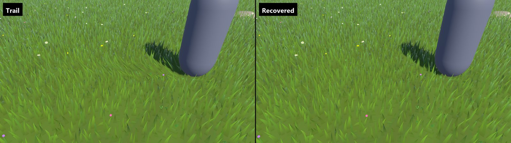

# Interaction

A **Grass Collider Interactor** makes a character's collider bend the grass it walks through. The bent grass recovers smoothly over a set time after the character leaves. The same bend drives the blade colour pass, contact shadows and motion vectors, so they always agree.


*Trail | Recovered, Meadow sample · 2.0.0 · 11-01*

## Set up

1. Select the character and add **Add Component > Cone > Grass > Collider Interactor**.
2. Assign **Actor Collider**: the character's real collider. If the object has exactly one collider, it is assigned for you.
3. If the collider is on a child, set **Actor Root** to the character's root, so the ground query ignores the character's own colliders.
4. Make sure the ground under the grass is a supported surface (below).
5. Choose **Update Mode**: **Late Update** for a character moved in `Update` (a CharacterController), **Fixed Update** for a Rigidbody character.

The Meadow sample's character is set up this way, with a CharacterController.

Interaction runs in Edit mode too, so you can drag a character through the grass in the Scene view.

## Supported colliders

| Collider | Notes |
|---|---|
| CharacterController | Recommended for characters. |
| CapsuleCollider | Must stand upright (Y axis). |
| SphereCollider | For balls and round props. |

The collider must be active, enabled and not a trigger. Box and mesh colliders, sideways capsules and sheared transforms are not supported: the interactor stops producing contact rather than guess a footprint.

The footprint is the collider's circular cross-section at the ground. **Footprint Padding** widens the bend without changing the ground query.

## Support: which ground counts

The interactor bends grass only when the collider stands on the surface that owns that grass. It casts down from the collider and accepts contact when:

- the ground is a **Placement Area's** Terrain (through its **Terrain Collider**, using the same TerrainData) or its **Paint Surface** collider; or
- for legacy or generic surfaces, the ground is the **Explicit Support** collider you assigned;
- and that surface is on **Accepted Support Layers** (default Everything);
- and the gap below the collider is within **Ground Clearance**, or the collider is sunk no deeper than **Allowed Penetration**.

A nearer unrelated floor (a bridge, a rock), a missing support, or two grass areas on different surfaces under the same footprint reject contact. This stops a character on a balcony from flattening the lawn below it.

### Uncovered support layers

**Uncovered Support Layers** (default Nothing) lists floors that carry contacts where no grass area reaches, such as a stone path or a dungeon floor. Nothing grows there, but effects that read the [shared interaction field](#shared-interaction-field) still see footsteps. Grass areas within reach keep their own ownership. From a script, set `UncoveredSupportLayers`.

## Bending and recovery

| Setting | Default | Effect |
|---|---|---|
| Bend Strength | 0.85 | Largest bend. |
| Attack Duration | 0 s | Time constant of the response to contact. 0 bends at once; 0.05 to 0.1 softens it. |
| Recovery Duration | 2 s | Time for the grass to stand up fully after the footprint leaves. |

The trail is stored on a fixed world grid (**Grid Spacing**, 0.15 m). Each grid sample keeps the last time a footprint covered it and the push direction, so standing still does not stack up the bend. Movement between two samples is swept, so a fast character leaves a continuous trail at any frame rate, within **Node Capacity** (1024 samples, up to 2048).

The visible detail is also limited by the grass capture: one capture pixel is about 0.6 m at the default **Draw Distance** (300 m) and **Capture Resolution** (1024). For a sharper trail, lower the draw distance or raise the capture resolution.

### Budgets

- If the trail needs more samples than **Node Capacity**, the old trail is cleared and only the current footprint is kept.
- If even the current footprint is too large, nothing is drawn and the interactor reports `TrailBudgetExceeded`. Raise **Grid Spacing** or use a smaller collider.
- Long trails: raise **Grid Spacing**, shorten **Recovery Duration**, or raise **Node Capacity**.

## Teleports and resets

The trail is cleared automatically when:

- the collider moves farther than **Teleport Distance** (5 m) between two samples;
- more than 0.25 s passes between two samples, or time runs backwards;
- the supporting surface is disabled, destroyed or moved.

Call `ClearHistory()` yourself after a respawn, a level reset, a floating-origin shift, or any move that stays under Teleport Distance but should not leave a trail. To reuse the component for another character, call `Configure(actor, support, selfRoot)`, which also clears the trail.

```csharp
using Cone.Grass;
using UnityEngine;

public class Respawn : MonoBehaviour
{
    [SerializeField] private GrassColliderInteractor grass;

    public void MoveTo(Vector3 position)
    {
        transform.position = position;
        grass.ClearHistory();
    }
}
```

For an external clock (a replay, a network tick), set **Update Mode** to **Manual** and call `Sample(time)` once per observation, with a finite time that never decreases.

## Diagnosing

`State` and `Diagnostic` tell you what the interactor is doing. See [bending not working](troubleshooting.md#bending-does-not-work).

## Grass Interactor

**Grass Interactor** (**Cone > Grass > Interactor**) is the interaction component from earlier versions. It is a Grass Collider Interactor with the older field names (**Body**, **Ground Layers**, **Radius Padding**, **Blade Height**, **Strength**, **Attack Seconds**, **Recovery Seconds**) and different defaults: a faster attack (0.06 s) and a short recovery (0.55 s). It always weakens the bend as the collider rises through **Blade Height**. Use it to keep existing scenes; use Grass Collider Interactor for new ones.

## Shared interaction field

Other effects can read the grass interaction capture instead of simulating their own: fog that parts around a character, footprints in snow. After each camera's capture, the renderer feature sets three global shader properties:

| Global | Contents |
|---|---|
| `_ConeInteractionField` | The capture texture. `rg` holds the push direction as `dir * 0.5 + 0.5`, premultiplied by `a`; `a` holds the contact strength. |
| `_ConeInteractionFieldST` | World X/Z to UV: `uv = positionWS.xz * ST.xy + ST.zw`. |
| `_ConeInteractionFieldParams` | `x` is 1 while a field is published, 0 otherwise. |

A camera that does not draw the grass withdraws the flag, so readers on that camera see no field rather than another camera's. A renderer feature that reads the field must run after the grass feature in the same frame; the grass pass runs before transparents. See [Integrations](integrations.md#reading-the-interaction-field) for a shader example.

To keep the field alive where no grass grows at all, turn off **Draw Blades** on the Infinite Grass Renderer: the feature then runs only the interaction capture, over the same window.
