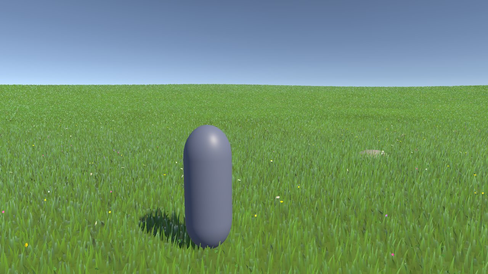
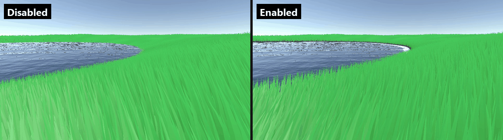

# Infinite Grass

GPU procedural grass and meadow flowers for URP terrain in Unity 6.



## Features

- **GPU generation.** A compute shader places every blade each frame around the camera and draws it with indirect instanced draws, through a URP RenderGraph renderer feature. No GameObjects or terrain detail layers per blade.
- **Authored placement.** Placement Areas (circle, box or texture) on Terrain or mesh surfaces, with a Scene-view density brush and Undo.
- **Plant kinds.** Up to eight kinds of grass, herb and flower per renderer, mixed by weight, clumped into drifts, sorted by moisture and slope, with procedural flower heads (daisy, cup, umbel, spike, puff, clover) or your own mesh.
- **Geometric LOD.** Near, middle and far blade meshes, a distance density fade and per-LOD GPU queues.
- **Ground colour matching.** Blade roots take the colour of the terrain below, from a TerrainLayer or a baked blend of all terrain layers.
- **Collider interaction.** Characters bend the grass as they walk, and it recovers over time. The contact field is shared with other effects.
- **Water line.** No grass or flowers below a water level, with a shoreline band where they thin in; optionally driven by Crest 5 water.

  
- **Optional extras.** Screen-space contact shadows, per-blade motion vectors for TAA and motion blur, and a MicroVerse mask bridge.

## Requirements

- Unity 6000.6
- Universal Render Pipeline 17.6 with RenderGraph, Universal Renderer
- A GPU with compute shaders, instancing and indirect draws. Intended for desktop DirectX 11, DirectX 12, Vulkan and Metal; tested on Direct3D 12 on Windows.

## Install

In **Window > Package Manager**, click **+ > Install package from git URL...** and enter:

```
https://github.com/coen22/com.cone.grass.git#v2.0.0
```

## Quick start

1. Add an empty GameObject with an **Infinite Grass Renderer** and assign the **Grass Blade** material.
2. In its inspector, click **Add Grass Data Renderer Feature** (or **Tools > Cone > Grass > Add Renderer Feature to Active Renderer**).
3. Add **Cone > Grass > Placement Area** to another GameObject and assign your **Terrain**.
4. Choose a **Circle** or **Box** shape, set its **Size** and move it where the grass should grow.
5. Set the area's **Ground Layer** to the TerrainLayer under it and raise **Ground Color Strength** to 1.

To make a character bend the grass, add **Cone > Grass > Collider Interactor** next to its CharacterController. For flowers, create a **Cone > Grass > Variant Profile** asset and assign it to the renderer's **Variants**.

The full walkthrough is in [Getting started](Documentation~/getting-started.md).

## Samples

Import from the **Samples** tab of the package in Package Manager.

- **Meadow**: a terrain meadow with flowers at grass height and a character whose collider bends the grass. **WASD** to walk, **Shift** to run, right mouse to orbit; the character walks on its own when idle. See [its README](Samples~/Meadow/README.md).
- **MicroVerse Mask Bridge**: optional; connects saved MicroVerse mask outputs to Placement Areas and matching terrain colours. Requires MicroVerse. See [its README](Integrations~/MicroVerse/README.md).

## Documentation

The manual starts at [Documentation~/index.md](Documentation~/index.md):

- [Getting started](Documentation~/getting-started.md)
- [Concepts](Documentation~/concepts.md)
- [Reference](Documentation~/reference.md)
- [Plant kinds and flowers](Documentation~/plant-kinds.md)
- [Interaction](Documentation~/interaction.md)
- [Performance](Documentation~/performance.md)
- [Troubleshooting](Documentation~/troubleshooting.md)
- [Integrations](Documentation~/integrations.md)
- [Upgrading from 1.x](Documentation~/upgrading.md)

Changes are listed in the [changelog](CHANGELOG.md).

## License

MIT. See [LICENSE.md](LICENSE.md).

Based on the original [Infinite Grass](https://youtu.be/NwVtPIxUuCY) by Youssef Afella. Version 2 and the Unity package by coen22.
